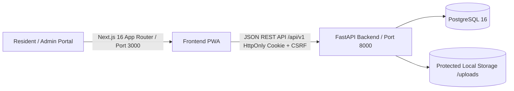

# SABTRACK 3.0

> **A Web-Based Solid Waste Management, Community Reporting, and Analytics System for Barangay Sabang, Lipa City, Batangas**

[](https://batstate-u.edu.ph/)
[](https://sdgs.un.org/goals/goal11)
[](https://fastapi.tiangolo.com/)
[](https://nextjs.org/)
[](https://www.postgresql.org/)
[](#phase-status)

---

## 1. Project Background

**SABTRACK** is an academic digital governance initiative developed under **IT 313 (System Analysis and Design)** at **Batangas State University – The National Engineering University, Lipa Campus**. Developed in cooperation with **Barangay Sabang, Lipa City, Batangas**, the platform addresses critical community solid waste management needs:
- Transparent publication of garbage collection schedules and change advisories.
- Verified, photo-based reporting of community waste violations and uncollected garbage.
- Recording verified community participation through the **SAB-Points** civic engagement ledger.
- A multi-step **Business Analytics Procedure** for authorized officials to monitor waste patterns and resolution turnaround times.
- Bounded, privacy-preserving AI decision support for administrative summary briefings.
- Compliance with the **Philippine Data Privacy Act of 2012 (RA 10173)** through automatic server-side EXIF GPS telemetry stripping, authenticated storage streams, and persistent brute-force defense.

---

## 2. Approved Academic Topic Form Details

- **Official Approved Topic Title:**  
  *SABTRACK: A Digital Governance Platform for Garbage Collection Scheduling, Community Violation Reporting, and Gamified Waste Management Engagement in Barangay Sabang*
- **Client Agency:** Barangay Sabang (Barangay Council / Local Government Unit), Lipa City, Batangas
- **Proponents:**
  - Jazztin H. Perez
  - Faith A. Valencia
  - May Sigrid M. Dimaano
- **Primary SDG Alignment:** **SDG 11 (Sustainable Cities and Communities)** — Target 11.6

---

## 3. Technology Stack & Architecture

SABTRACK is engineered as a **Modular Monolith** with a decoupled frontend:



- **Frontend:** Next.js 16, React 19, TypeScript, Tailwind CSS, shadcn/ui tokens.
- **Backend:** Python 3.13, FastAPI, Pydantic v2, SQLAlchemy 2.0, Alembic, psycopg 3.x, Pillow.
- **Database:** PostgreSQL 16 (Primary development and production database).
- **Security:** Argon2id password hashing, server-managed HttpOnly session cookies, CSRF double-submit protection, database-persisted brute force rate limiting, server-side EXIF GPS stripping.
- **Testing:** Pytest (Backend API & RBAC integration tests), Vitest (React component tests).

---

## 4. Phase Status

| Phase | Description | Status | Commit References |
|---|---|---|---|
| **Phase 1** | Foundation — FastAPI, PostgreSQL, Next.js, Health Check, Design System | ✅ Complete | `b5831f4` |
| **Phase 2** | Identity, RBAC, Sessions, CSRF, Portal Navigation Shells | ✅ Complete | `098632c` |
| **Phase 3** | Core Waste Operations — Reports, Schedules, Advisories, Announcements, User Management | ✅ Complete | `b38e62c`, `864b60f` |
| **Phase 4** | SAB-Points Ledger, 6-Step Analytics Engine & Live Dashboards | ✅ Complete | `8477453`, `864b60f` |
| **Phase 5** | Production Deployment, Multipart Storage Hardening, EXIF Stripping & Defense Prep | ✅ Complete | `3b49b61`, `4b64f87`, `96a768e`, `ca22277` |

---

## 5. Local Quick Start (Windows)

### Prerequisites
- Python 3.13+ installed
- Node.js v22+ installed
- Git installed
- PostgreSQL 16 (See [docs/DEVELOPMENT_SETUP.md](docs/DEVELOPMENT_SETUP.md) for Windows installation instructions)

### Setup Steps
```cmd
REM 1. Clone and enter the project
git clone <repo-url> SABTRACK-3.0
cd SABTRACK-3.0

REM 2. Configure Backend Environment
copy apps\api\.env.example apps\api\.env
cd apps\api
python -m venv .venv
.\.venv\Scripts\activate
pip install -r requirements.txt
alembic upgrade head
python ..\..\scripts\seed-users.py
cd ..\..

REM 3. Configure Frontend Environment
copy apps\web\.env.example apps\web\.env.local
cd apps\web
npm install
cd ..\..

REM 4. Launch both services
.\scripts\dev.bat
```

Services will be available at:
- Frontend: `http://localhost:3000`
- API Documentation: `http://localhost:8000/api/v1/docs`

---

## 6. Automated Verification & Testing

Run the full cross-stack test suite:
```cmd
.\scripts\run-tests.bat
```

**Current test results (Phase 5 Complete):**
- ✅ Backend Pytest: **52/52** (Health, Auth/RBAC, Reports, Schedules, Announcements, Gamification, Analytics, Users, Storage/Uploads, Persistent Rate Limiting)
- ✅ Frontend Vitest: **14/14** (HealthDashboard, LoginPage, AnalyticsPage, UsersPage, ImageUpload)
- ✅ Next.js build: **Clean** (zero TypeScript errors, 18 routes)
- **Total Passing Automated Tests:** **66/66**

---

## 7. Project Documentation & Governance

- [docs/ARCHITECTURE.md](docs/ARCHITECTURE.md) — System architecture, session lifecycle, RBAC matrix, ER diagrams, storage security, and analytics procedure.
- [docs/DECISION_LOG.md](docs/DECISION_LOG.md) — Living log of confirmed, proposed, and pending architectural decisions.
- [docs/DEVELOPMENT_SETUP.md](docs/DEVELOPMENT_SETUP.md) — Step-by-step Windows setup, PostgreSQL configuration, seeding, and demo login runbook.
- [AGENTS.md](AGENTS.md) — Mandatory guidelines and guardrails for AI coding assistants.

---

## 8. Research Ethics & Data Privacy

The project strictly complies with the **Philippine Data Privacy Act of 2012 (RA 10173)**:
- Complainant personal data is minimized and shielded from public access.
- Image uploads are stored in an authenticated non-public directory with EXIF telemetry stripped via Pillow.
- Brute force authentication attempts are persistently throttled via PostgreSQL records.
- Demonstration data in development is synthetic (`is_demo_data=True`).
- Session tokens are stored as SHA-256 hashes only; never persisted in plaintext.
- Official field operational rules and zoning boundaries are subject to ongoing barangay validation.
