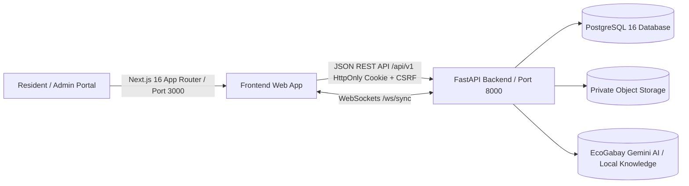

# SABTRACK 3.0

> **A Digital Solid Waste Management and Community Engagement Platform for Barangay Sabang**


-black.svg)

-brightgreen.svg)


---

## 1. Project Background &amp; Governance

**SABTRACK** is an academic digital governance and environmental management platform engineered under **IT 313 (System Analysis and Design)** at **Batangas State University – The National Engineering University, Lipa Campus**. Developed in active cooperation with **Barangay Sabang, Lipa City, Batangas**, the platform modernizes grassroots solid waste operations, drives community civic engagement, and enforces municipal accountability:

- **Official Approved Topic Title:**  
*SABTRACK: A Digital Solid Waste Management and Community Engagement Platform for Barangay Sabang*
- **Client Agency:** Barangay Sabang (Barangay Council / Local Government Unit), Lipa City, Batangas
- **Proponents:**
  - Jazztin H. Perez
  - Faith A. Valencia
  - May Sigrid M. Dimaano
- **Primary SDG Alignments:**
  - **SDG 11 (Sustainable Cities &amp; Communities):** Target 11.6 — Reduce environmental impact of municipal waste.
  - **SDG 12 (Responsible Consumption &amp; Production):** Target 12.5 — Substantially reduce waste generation through prevention, reduction, recycling, and reuse.

---

## 2. Core System Modules

SABTRACK 3.0 delivers a cohesive municipal waste governance ecosystem with specialized experiences for Residents, Barangay Staff, and Barangay Administrators:

### ♻️ Collection Schedules &amp; Route Notifications

- Interactive calendar and table views of garbage collection routes filtered by Purok (Purok 1 through Purok 7).
- Real-time resident notification registration via email advisories for collection days, delays, or emergency schedule changes.
- Administrative schedule editor with real-time broadcast propagation.

### 📸 Verified Community Waste Reporting

- Resident incident filing with mandatory photo evidence, incident category (Violations, Uncollected Garbage, Illegal Dumping, Overflowing Bins), and Purok geolocation.
- **Privacy Enforcement (RA 10173):** Server-side camera EXIF GPS scrubbing upon image ingestion to protect resident privacy.
- Interactive **PhotoZoom Modal** allowing reviewers to inspect evidence with pan, zoom, and reset controls.
- Immutable status lifecycle: `PENDING` ➔ `INVESTIGATING` ➔ `IN_PROGRESS` ➔ `RESOLVED` / `DISMISSED` with full reviewer audit timestamps.

### 🎖️ SAB-Points Gamification &amp; Rewards Store

- **Audited Civic Ledger:** Cryptographically signed ledger records for all point earnings, claims, and voucher redemptions.
- **Civic Action Tasks:** Earn points for daily waste segregation (25 pts), reporting violations with verified evidence (50 pts), and zero-violation monthly records (100 pts).
- **Physical Goods &amp; Airtime Redemption:** Redeem earned points for physical rewards (5kg/10kg Rice packs, Grocery packages, Mobile Load 100 PHP).
- **Secure 8-Character Vouchers:** Instant generation of unique alphanumeric redemption vouchers with one-click copy and QR verification codes.

### 🛡️ Integrated Identity Verification (OCR + Face Biometrics)

- **Government ID OCR Scanning:** Browser and server-side OCR supporting PhilSys National ID, Driver's License, SSS/UMID, Postal ID, Passport, Voter's ID, and Senior/PWD IDs.
- **Liveness Face Biometrics:** Live webcam/mobile camera capture with posture detection, alignment overlays, and facial verification against government ID photos.
- Automated validation of citizen identity upon registration with verified badges displayed on resident profiles.

### 📚 Awareness Hub &amp; Continuous Reading Rewards

- Interactive educational repository with segregation matrices, Philippine legal bases (RA 9003, Clean Air Act, EPR Act of 2022), and Barangay Sabang sustainability benchmarks.
- **45-Second Heartbeat Reward Engine:** Residents reading verified educational guides earn +5 SAB-Points upon completion, enforced by active heartbeat timers.
- Verified educational video catalogs with direct YouTube tutorials and expandable FAQ accordions.

### 🤖 EcoGabay AI Chatbot

- Bilingual (Tagalog / English) assistant for waste segregation, local collection rules, and upcycling ideas.
- Embedded upcycling project catalog with materials lists, step-by-step procedures, and academic citations.
- Movable, draggable floating widget with auto-close outside and keyboard dismissal.

### 📊 Executive Business Analytics &amp; Memorandum Export

- 6-stage analytics procedure analyzing report volumes, resolution rates, and Purok compliance patterns.
- Geographic hotspot matrix identifying high-frequency violation areas across Purok 1–7.
- Predictive forecasting model for waste volume trends and municipal risk assessment.
- One-click generation of printable/downloadable official PDF memoranda for barangay council sessions.

---

## 3. Technology Stack &amp; Architecture

SABTRACK 3.0 is built as a **Modular Monolith** with decoupled frontend and backend services:




| Layer        | Technologies                                                     | Key Features                                                                                                   |
| ------------ | ---------------------------------------------------------------- | -------------------------------------------------------------------------------------------------------------- |
| **Frontend** | Next.js 16 (Turbopack), React 19, TypeScript, Tailwind CSS       | Minimal Green Neumorphic Design (`#0F5132`, `#198754`, `#f4f8f5`), Responsive Layout, Real-time WebSocket sync |
| **Backend**  | Python 3.13, FastAPI 0.115, Pydantic v2, SQLAlchemy 2.0, Alembic | Modular API architecture, background tasks, OCR service, facial biometric matching                             |
| **Database** | PostgreSQL 16, psycopg 3.x                                       | 14 Alembic schema migrations, relational constraints, foreign keys, audited ledger                             |
| **Security** | Argon2id, Secure HttpOnly Cookies, Double-Submit CSRF            | 3-Role RBAC (`RESIDENT`, `BARANGAY_STAFF`, `BARANGAY_ADMIN`), IP/Account rate limiting with live countdown     |
| **Testing**  | Pytest, Starlette TestClient, Vitest, React Testing Library      | 283 hermetic tests covering 100% of core APIs, RBAC rules, and UI components                                   |


---

## 4. Project Directory Layout

```text
SABTRACK-3.0/
├── apps/
│   ├── api/                           # Backend Application
│   │   ├── alembic/                   # Alembic migrations (0001 - 0014)
│   │   ├── app/                       # FastAPI application
│   │   │   ├── api/v1/endpoints/      # REST API route controllers
│   │   │   ├── core/                  # Security, database, websocket, errors
│   │   │   └── modules/               # Domain services (identity, reports, gamification...)
│   │   ├── tests/                     # 22 Hermetic Pytest test suites (141 tests)
│   │   ├── requirements.txt           # Python dependency specifications
│   │   ├── alembic.ini                # Alembic database configuration
│   │   └── Dockerfile                 # Backend containerization
│   └── web/                           # Frontend Application
│       ├── public/                    # Badges, rewards, task images, civic assets
│       ├── src/                       # Next.js 16 App Router
│       │   ├── app/                   # App Router pages (/resident, /admin, /login...)
│       │   ├── components/            # Reusable UI widgets, modals, headers, footers
│       │   ├── lib/                   # API clients, auth context, real-time sync
│       │   └── types/                 # TypeScript type definitions
│       ├── tests/                     # 29 Vitest UI component test suites (142 tests)
│       └── package.json               # Node.js dependencies
├── scripts/                           # Operational Batch Runners
│   ├── dev.bat                        # Concurrent full-stack dev server launcher
│   ├── init-database.bat              # Setup & migrate PostgreSQL database
│   ├── install-postgres.bat           # PostgreSQL installer helper
│   ├── run-api.bat                    # Start backend server
│   ├── run-web.bat                    # Start frontend server
│   ├── run-tests.bat                  # Full automated test suite runner
│   ├── seed-users.bat                 # Development demo account seeder
│   └── seed-users.py                  # Seeder logic
├── .gitignore                         # Project ignore specifications
├── docker-compose.yml                 # Database & container configuration
└── README.md                          # Primary project documentation
```

---

## 5. Local Quick Start (Windows)

### Prerequisites

- **Python 3.13+** installed
- **Node.js v22+** installed
- **Git** installed
- **PostgreSQL 16** (or run `.\scripts\install-postgres.bat`)

### Setup Steps

```cmd
REM 1. Clone repository
git clone https://github.com/perezjazztin/SABTRACK-3.0.git
cd SABTRACK-3.0

REM 2. Initialize and migrate the PostgreSQL database
.\scripts\init-database.bat

REM 3. Seed demonstration accounts (Development)
.\scripts\seed-users.bat

REM 4. Launch both Backend and Frontend concurrently
.\scripts\dev.bat
```

### Service Endpoints

- **Frontend Web Application:** [http://localhost:3000](http://localhost:3000)
- **Backend REST API:** [http://127.0.0.1:8000](http://127.0.0.1:8000)
- **Interactive Swagger Documentation:** [http://127.0.0.1:8000/api/v1/docs](http://127.0.0.1:8000/api/v1/docs)
- **Health Diagnostics:** [http://127.0.0.1:8000/api/v1/health](http://127.0.0.1:8000/api/v1/health)

---

## 6. Demonstration Accounts

Navigate to [http://localhost:3000/login](http://localhost:3000/login) to evaluate the system under any of the 3 role-isolated access levels:


| Role               | Email                          | Password               | Access Scope                                                                          |
| ------------------ | ------------------------------ | ---------------------- | ------------------------------------------------------------------------------------- |
| **Resident**       | `resident.demo@sabtrack.local` | `SabtrackDevPass2026!` | Resident Portal, Incident Reporting, SAB-Points, Awareness Hub, Schedules             |
| **Barangay Staff** | `staff.demo@sabtrack.local`    | `SabtrackDevPass2026!` | Staff Console, Incident Review &amp; Verification, Announcements, View-Only Analytics |
| **Barangay Admin** | `admin.demo@sabtrack.local`    | `SabtrackDevPass2026!` | Admin Console, Full Analytics, Memorandum Export, User Management, Schedules          |


---

## 7. Running Automated Tests

Run the full unified test suite across both frontend and backend:

```cmd
.\scripts\run-tests.bat
```

### Verified Test Results

- ✅ **Backend Pytest:** **141 / 141 passed (100%)** across 22 test files (Identity, RBAC, Reports, Gamification, Schedules, Storage, Chatbot, Analytics, WebSockets, OCR &amp; Biometrics)
- ✅ **Frontend Vitest:** **142 / 142 passed (100%)** across 29 test files
- ✅ **Total Test Suite:** **283 / 283 passed (100%)**
- ✅ **Next.js Production Build:** **20 / 20 static routes prerendered cleanly (0 TypeScript errors)**

---

## 8. Research Ethics &amp; Data Privacy

SABTRACK strictly complies with the **Philippine Data Privacy Act of 2012 (RA 10173)**:

- **Telemetry Stripping:** All uploaded community violation photos have camera EXIF metadata (GPS coordinates, camera serials, timestamps) stripped at ingestion before storage.
- **Data Minimization:** Complainant identities are strictly shielded from public view and restricted to authorized officials.
- **Secure Tokenization:** User passwords use Argon2id hashing; authentication tokens are stored exclusively as SHA-256 hashes at rest in the database.
- **Synthetic Demonstration:** All development and demonstration accounts operate on synthetic data (`is_demo_data=True`).