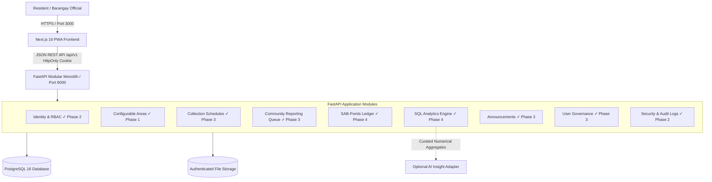
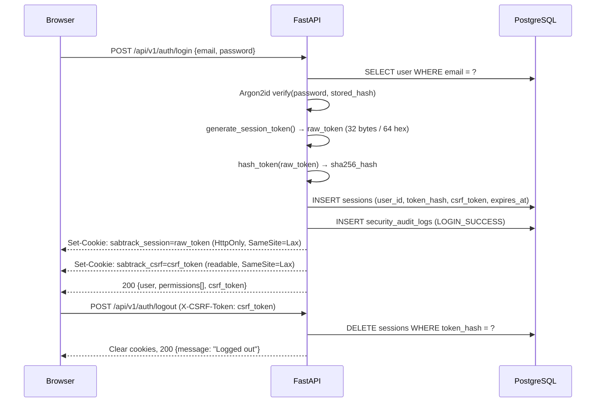
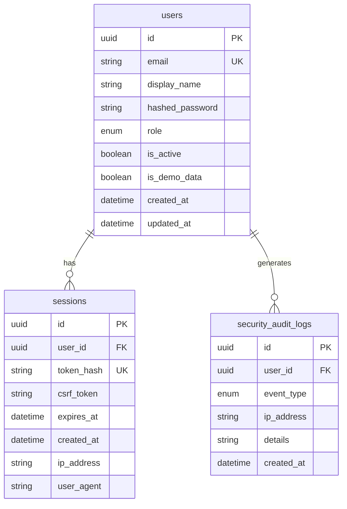

# SABTRACK 3.0 — Architecture & System Design Document

**Course:** IT 313 — System Analysis and Design  
**Client / Community:** Barangay Sabang, Lipa City, Batangas  
**Proponents:** Jazztin H. Perez, Faith A. Valencia, May Sigrid M. Dimaano  
**Status:** Phase 4 Analytics & Gamification Complete — Phase 5 Hardening & Deployment Pending  

---

## 1. System Overview

SABTRACK 3.0 is a web-based solid waste management and community engagement platform designed for Barangay Sabang, Lipa City. It consists of a decoupled frontend Progressive Web App (Next.js) and a modular monolith backend (FastAPI) backed by PostgreSQL.



---

## 2. Core Architectural Principles

1. **Modular Monolith over Microservices:**  
   Organized as cohesive internal Python packages (`app/modules/*`) sharing a single relational database. This preserves transactional integrity (ACID) and avoids distributed transaction failure modes for a three-person engineering team.

2. **Backend as the Authority:**  
   The FastAPI backend enforces all access control (RBAC), state transitions, validation, and point calculations. The frontend is strictly a presentation and interaction layer. Frontend visibility checks (hiding nav items) are UX optimizations only — never trusted as security controls.

3. **Dynamic & Configurable Geographies:**  
   No hardcoded puroks or fixed geographic assumptions. The `areas` schema dynamically represents administrative divisions, collection routes, or puroks as validated by Barangay Sabang. Synthetic demonstration records are explicitly tagged (`is_demo_data=True`).

4. **Immutable State & Ledger Discipline:**  
   - Report status changes are never overwritten in-place; each transition is logged in `report_status_history`.
   - Points are tracked through an append-only `point_ledger` (`EARNED`, `REVERSED`, `REDEEMED`).

---

## 3. Technology Stack Reference

| Component | Technology | Version | Purpose |
|---|---|---|---|
| **Frontend Framework** | Next.js (App Router) | `16.4.x` / React `19.3.x` | Component architecture, responsive PWA shell |
| **Frontend Styling** | Tailwind CSS + shadcn tokens | `3.4.x` | Accessible civic UI primitives |
| **Frontend Testing** | Vitest + Testing Library | `3.0.x` | Unit & component behavior verification |
| **Backend Framework** | FastAPI | `0.143.x` | Typed REST API with OpenAPI autogeneration |
| **Data Validation** | Pydantic v2 | `2.14.x` | Server-side request/response contracts |
| **ORM** | SQLAlchemy 2.0 | `2.1.x` | Typed relational mapping and queries |
| **Migrations** | Alembic | `1.20.x` | Version-controlled database migrations |
| **Database Driver** | Psycopg 3.x | `3.3.x` | Native high-performance PostgreSQL driver |
| **Database** | PostgreSQL | `16.x` | Primary relational store |
| **Backend Testing** | Pytest | `9.1.x` | API integration & unit testing |
| **Password Hashing** | argon2-cffi | `25.1.x` | Argon2id memory-hard password hashing |

---

## 4. Phase 2 — Authentication & Session Architecture

### 4.1 Session Lifecycle



### 4.2 Request Authentication Flow

Every protected endpoint uses `get_current_user()` as a FastAPI dependency:

1. Read `sabtrack_session` cookie → SHA-256 hash → query `sessions` table.
2. Verify `session.expires_at` (with timezone normalization for cross-DB compatibility).
3. Join `Session.user` → return `User` model.
4. For state-mutating requests (POST/PUT/PATCH/DELETE): `verify_csrf()` checks `X-CSRF-Token` header against `session.csrf_token`.

### 4.3 Cookie Configuration

| Cookie | `HttpOnly` | `Secure` | `SameSite` | Purpose |
|---|---|---|---|---|
| `sabtrack_session` | ✅ Yes | `False` (dev) / `True` (prod) | `Lax` | Session opaque token |
| `sabtrack_csrf` | ❌ No | `False` (dev) / `True` (prod) | `Lax` | CSRF double-submit value |

> **Important:** `SESSION_COOKIE_SECURE` must be set to `True` in the production `.env` file. The default `False` is only safe for local HTTP development.

### 4.4 CORS & Credentials Strategy

- `allow_origins=["http://localhost:3000"]` (dev) — never `"*"` when `allow_credentials=True`.
- Frontend `apiFetch()` always sends `credentials: 'include'` so cookies are transmitted cross-port (`:3000` → `:8000`).

---

## 5. Phase 2 — Role-Based Access Control (RBAC)

### 5.1 Role-Permission Matrix

| Permission | RESIDENT | BARANGAY_STAFF | BARANGAY_ADMIN | SYSTEM_MAINTAINER |
|---|:---:|:---:|:---:|:---:|
| `profile:read:self` | ✅ | ✅ | ✅ | ✅ |
| `profile:update:self` | ✅ | ✅ | ✅ | ❌ |
| `reports:create` | ✅ | ✅ | ✅ | ❌ |
| `reports:read:self` | ✅ | ✅ | ✅ | ❌ |
| `reports:review` | ❌ | ✅ | ✅ | ❌ |
| `schedules:manage` | ❌ | ❌ | ✅ | ❌ |
| `announcements:manage` | ❌ | ✅ | ✅ | ❌ |
| `participation:review` | ❌ | ✅ | ✅ | ❌ |
| `analytics:read` | ❌ | ❌ | ✅ | ❌ |
| `users:manage` | ❌ | ❌ | ✅ | ❌ |
| `system:diagnostics` | ❌ | ❌ | ❌ | ✅ |

> **Least-Privilege Note:** `SYSTEM_MAINTAINER` is intentionally restricted. It cannot access resident reports, manage users, or perform administrative barangay functions. It exists solely for infrastructure diagnostics.

### 5.2 Permission Enforcement Pattern

```python
# Endpoint-level enforcement in FastAPI
@router.get("/admin/reports-queue")
async def admin_reports(
    user: User = Depends(require_permission(Permission.REPORTS_REVIEW))
):
    ...
```

The `require_permission()` factory returns a dependency that:
1. Calls `get_current_user()` (session validation).
2. Looks up `ROLE_PERMISSIONS[user.role]`.
3. Returns `403 Forbidden` if the required permission is absent.

---

## 6. Phase 2 — Database Schema

### Migration 0002: identity_and_sessions



---

## 7. Phase 2 — Frontend Navigation Structure

### Resident Portal (`/resident/*`)
Protected by `ProtectedRoute` requiring `RESIDENT | BARANGAY_STAFF | BARANGAY_ADMIN` role.

| Route | Page | Status |
|---|---|---|
| `/resident` | Dashboard | Placeholder (Phase 3) |
| `/resident/schedules` | Collection Schedules | Placeholder (Phase 3) |
| `/resident/reports` | My Reports | Placeholder (Phase 3) |
| `/resident/points` | SAB-Points | Placeholder (Phase 4) |
| `/resident/announcements` | Announcements | Placeholder (Phase 3) |
| `/resident/profile` | Profile | **Live** — shows user identity |

### Admin Portal (`/admin/*`)
Protected by `ProtectedRoute` requiring `BARANGAY_STAFF | BARANGAY_ADMIN` role.

| Route | Page | Min Role | Status |
|---|---|---|---|
| `/admin` | Overview | STAFF | Placeholder (Phase 3) |
| `/admin/reports` | Report Management | STAFF | Placeholder (Phase 3) |
| `/admin/schedules` | Collection Schedules | ADMIN | Placeholder (Phase 3) |
| `/admin/participation` | Community Participation | STAFF | Placeholder (Phase 4) |
| `/admin/analytics` | Analytics & Insights | ADMIN | Placeholder (Phase 4) |
| `/admin/announcements` | Announcements | STAFF | Placeholder (Phase 3) |
| `/admin/users` | User Management | ADMIN | Placeholder (Phase 3) |

---

## 8. Security & Privacy Baseline (RA 10173)

- **Authentication:** Server-managed `HttpOnly`, `SameSite=Lax` cookies with anti-CSRF token verification on state mutations.
- **Password Storage:** Argon2id with CFFI bindings (`argon2-cffi 25.1`). No MD5, SHA-1, bcrypt, or plaintext.
- **Token Storage:** Session tokens stored as SHA-256 hash only. Raw token exists only in the HttpOnly cookie.
- **Rate Limiting:** 5 failed login attempts per IP per 15 minutes (in-memory; resets on server restart — acceptable for academic scope).
- **Audit Logging:** `security_audit_logs` table records `LOGIN_SUCCESS`, `LOGIN_FAILURE`, `LOGOUT`, `SESSION_EXPIRED` events with IP address.
- **Upload Isolation:** Evidence photos and attachments are stored in an authenticated directory, never exposed as public static files.
- **Metadata Sanitization:** Image EXIF metadata (GPS, device serials) is stripped upon upload.
- **Least Privilege RBAC:** Roles distinguish `RESIDENT`, `BARANGAY_STAFF`, `BARANGAY_ADMIN`, and `SYSTEM_MAINTAINER`.

---

## 9. Formal Business Analytics Procedure

The system implements the 6-step analytics procedure mandated by the course instructor:

$$\text{Operational Records} \xrightarrow{\text{1. Collect}} \text{Sanitization} \xrightarrow{\text{2. Clean}} \text{SQL Aggregation} \xrightarrow{\text{3. Aggregate}} \text{Pattern Detection} \xrightarrow{\text{4. Detect}} \text{Visual Indicators} \xrightarrow{\text{5. Visualize}} \text{Decision Support}$$

- **AI Safeguard:** The optional AI layer receives **only** pre-calculated numerical aggregates. No raw complaints, resident names, or photos are sent to external AI providers.

---

## 10. Outstanding Unresolved Items

| # | Item | Reason | Resolution Path |
|---|---|---|---|
| 1 | Actual purok/area boundaries for Barangay Sabang | Must be validated with barangay officials | Barangay interview or official document |
| 2 | Resident account onboarding and identity verification process | No confirmed barangay procedure | Requirements workshop with client |
| 3 | Resident account deletion / right-to-erasure procedure | RA 10173 compliance | Policy decision with barangay and legal review |
| 4 | Production session cookie domain (if custom domain used) | Infrastructure not yet decided | Phase 5 deployment planning |
| 5 | File storage backend (local vs. object storage) | Not yet provisioned | Phase 3 decision |
| 6 | Rate limiter persistence (in-memory resets on restart) | Acceptable for academic demo | Replace with Redis or DB-backed limiter for production |
