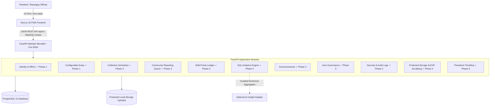
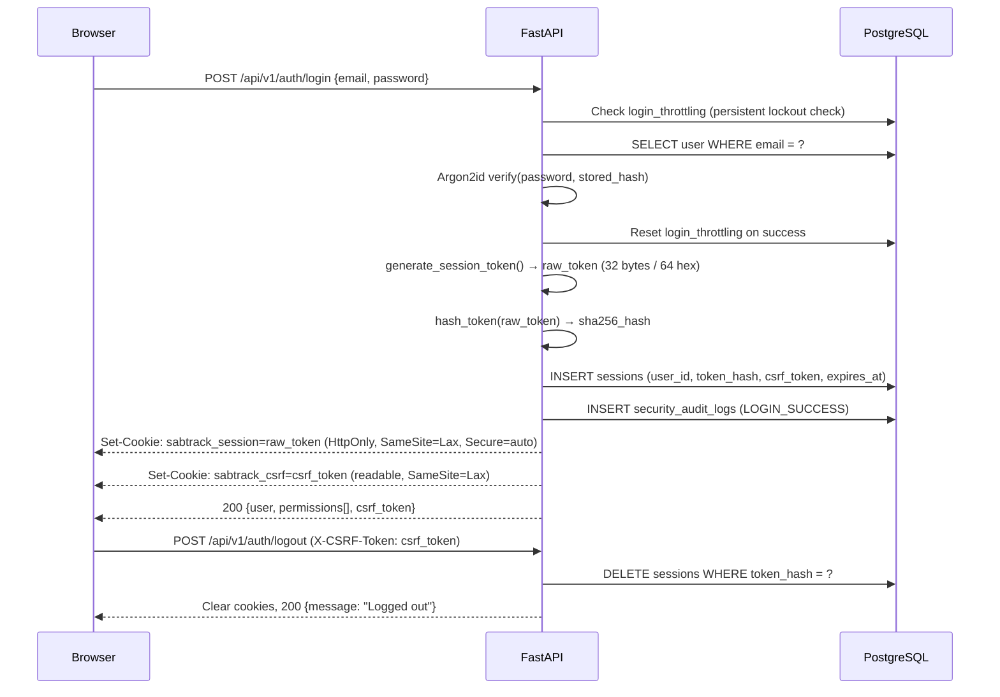

# SABTRACK 3.0 — Architecture & System Design Document

**Course:** IT 313 — System Analysis and Design  
**Client / Community:** Barangay Sabang, Lipa City, Batangas  
**Proponents:** Jazztin H. Perez, Faith A. Valencia, May Sigrid M. Dimaano  
**Status:** Phase 5 Production Hardening & Deployment Complete — All 5 Phases Verified (66/66 Automated Tests Passing)  

---

## 1. System Overview

SABTRACK 3.0 is a web-based solid waste management and community engagement platform designed for Barangay Sabang, Lipa City. It consists of a decoupled frontend Progressive Web App (Next.js) and a modular monolith backend (FastAPI) backed by PostgreSQL.

---

## 2. Core Architectural Principles

1. **Modular Monolith over Microservices:**  
   Organized as cohesive internal Python packages (`app/modules/*`) sharing a single relational database. This preserves transactional integrity (ACID) and avoids distributed transaction failure modes for a three-person engineering team.

2. **Backend as the Authority:**  
   The FastAPI backend enforces all access control (RBAC), state transitions, validation, and point calculations. The frontend is strictly a presentation and interaction layer. Frontend visibility checks (hiding nav items) are UX optimizations only — never trusted as security controls.

3. **Dynamic & Configurable Geographies:**  
   No hardcoded puroks or fixed geographic assumptions. The `areas` schema dynamically represents administrative divisions, collection routes, or puroks as validated by Barangay Sabang. Synthetic demonstration records are explicitly tagged (`is_demo_data=True`).

4. **Immutable State & Ledger Discipline:**  
   - Report status changes are never overwritten in-place; each transition is logged in `report_status_history`.
   - Points are tracked through an append-only `points_ledger` (`EARNED`, `REVERSED`, `REDEEMED`).

5. **Data Privacy & Telemetry Sanitization (RA 10173):**  
   - Citizen report evidence photos are scrubbed of all EXIF metadata (GPS telemetry, timestamps, camera hardware serials) via Pillow before persisting to disk.
   - Uploaded files are served strictly through authenticated streaming endpoints with directory traversal protection.
   - Brute-force authentication defense is persisted across restarts in the `login_throttling` table.

---

## 3. Technology Stack Reference

| Component | Technology | Version | Purpose |
|---|---|---|---|
| **Frontend Framework** | Next.js (App Router) | `16.4.x` / React `19.3.x` | Component architecture, responsive PWA shell |
| **Frontend Styling** | Tailwind CSS + shadcn tokens | `3.4.x` | Accessible civic UI primitives |
| **Frontend Testing** | Vitest + Testing Library | `3.0.x` | Unit & component behavior verification |
| **Backend Framework** | FastAPI | `0.143.x` | Typed REST API with OpenAPI autogeneration |
| **Data Validation** | Pydantic v2 | `2.14.x` | Server-side request/response contracts |
| **ORM** | SQLAlchemy 2.0 | `2.1.x` | Typed relational mapping and queries |
| **Migrations** | Alembic | `1.20.x` | Version-controlled database migrations |
| **Database Driver** | Psycopg 3.x | `3.3.x` | Native high-performance PostgreSQL driver |
| **Database** | PostgreSQL | `16.x` | Primary relational store |
| **Image Sanitization** | Pillow | `13.0.x` | EXIF GPS stripping and format validation |
| **Backend Testing** | Pytest | `9.1.x` | API integration & unit testing |
| **Password Hashing** | argon2-cffi | `25.1.x` | Argon2id memory-hard password hashing |

---

## 4. Authentication & Session Architecture

### 4.1 Session Lifecycle

---

## 5. Role-Based Access Control (RBAC)

### 5.1 Role-Permission Matrix

| Permission | RESIDENT | BARANGAY_STAFF | BARANGAY_ADMIN | SYSTEM_MAINTAINER |
|---|:---:|:---:|:---:|:---:|
| `profile:read:self` | ✅ | ✅ | ✅ | ✅ |
| `profile:update:self` | ✅ | ✅ | ✅ | ❌ |
| `reports:create` | ✅ | ✅ | ✅ | ❌ |
| `reports:read:self` | ✅ | ✅ | ✅ | ❌ |
| `reports:review` | ❌ | ✅ | ✅ | ❌ |
| `schedules:manage` | ❌ | ❌ | ✅ | ❌ |
| `announcements:manage` | ❌ | ✅ | ✅ | ❌ |
| `participation:review` | ❌ | ✅ | ✅ | ❌ |
| `analytics:read` | ❌ | ❌ | ✅ | ❌ |
| `users:manage` | ❌ | ❌ | ✅ | ❌ |
| `system:diagnostics` | ❌ | ❌ | ❌ | ✅ |

---

## 6. Comprehensive Database Schema (Migrations 0001–0007)

### Schema Evolution & Migration History

| Migration | Scope | Entities Created |
|---|---|---|
| `0001_initial_areas` | Geographic Foundation | `areas` |
| `0002_identity_and_sessions` | Identity & RBAC | `users`, `sessions`, `security_audit_logs` |
| `0003_community_waste_reports` | Waste Operations | `reports`, `report_status_history` |
| `0004_collection_schedules` | Collection Scheduling | `schedules`, `schedule_advisories` |
| `0005_announcements` | Civic Communications | `announcements` |
| `0006_gamification_and_points` | Civic Engagement | `initiatives`, `participation_claims`, `points_ledger` |
| `0007_login_throttling` | Brute-Force Defense | `login_throttling` |

---

## 7. Frontend Navigation Structure (Phase 5 Live State)

### Resident Portal (`/resident/*`)
Protected by `ProtectedRoute` requiring `RESIDENT | BARANGAY_STAFF | BARANGAY_ADMIN` role.

| Route | Page | Status | Description |
|---|---|---|---|
| `/resident` | Dashboard | **Live** | Quick stats, recent announcements, triage alerts |
| `/resident/schedules` | Collection Schedules | **Live** | Dynamic area timetables and delay advisories |
| `/resident/reports` | My Reports | **Live** | Violation submissions with EXIF-scrubbed photo upload & timeline |
| `/resident/points` | SAB-Points | **Live** | Points balance, ledger, and photo-verified claim submission |
| `/resident/announcements` | Announcements | **Live** | Barangay bulletins & urgent advisories |
| `/resident/profile` | Profile | **Live** | Authenticated user identity and active roles |

### Admin Portal (`/admin/*`)
Protected by `ProtectedRoute` requiring `BARANGAY_STAFF | BARANGAY_ADMIN` role.

| Route | Page | Min Role | Status | Description |
|---|---|---|---|---|
| `/admin` | Overview | STAFF | **Live** | Operational triage metrics & alert feeds |
| `/admin/reports` | Report Management | STAFF | **Live** | Triage queue, immutable status updates, sanitized photo review |
| `/admin/schedules` | Collection Schedules | ADMIN | **Live** | Timetable management & emergency delay broadcasts |
| `/admin/participation` | Community Participation | STAFF | **Live** | Civic initiative management & claim verification queue |
| `/admin/analytics` | Analytics & Insights | ADMIN | **Live** | 6-stage analytics dashboard with area hotspot classification |
| `/admin/announcements` | Announcements | STAFF | **Live** | Official communications composer & bulletin manager |
| `/admin/users` | User Management | ADMIN | **Live** | Staff provisioning & user account activation toggles |

---

## 8. Security & Privacy Baseline (RA 10173)

- **Authentication:** Server-managed `HttpOnly`, `SameSite=Lax` cookies with anti-CSRF token verification on state mutations.
- **Password Storage:** Argon2id with CFFI bindings (`argon2-cffi 25.1`).
- **Token Storage:** Session tokens stored as SHA-256 hash only. Raw token exists only in the HttpOnly cookie.
- **Persistent Rate Limiting:** 5 failed login attempts locks IP/email for 15 minutes; tracked in PostgreSQL `login_throttling` table to survive server reboots.
- **Audit Logging:** `security_audit_logs` table records `LOGIN_SUCCESS`, `LOGIN_FAILED`, `LOGOUT`, `SESSION_EXPIRED` events with IP address.
- **Protected File Storage:** Citizen photos are stored in an authenticated server directory (`apps/api/storage/uploads`), inaccessible via public web paths.
- **Metadata Sanitization:** Pillow automatically re-encodes uploaded images and strips all EXIF metadata (GPS telemetry, device serials).
- **Directory Traversal Defense:** Upload path resolution strictly verifies child paths against the configured storage root.
- **Least Privilege RBAC:** Roles distinguish `RESIDENT`, `BARANGAY_STAFF`, `BARANGAY_ADMIN`, and `SYSTEM_MAINTAINER`.

---

## 9. Formal Business Analytics Procedure

The system implements the 6-step analytics procedure mandated by the course instructor:

$$\text{Operational Records} \xrightarrow{\text{1. Collect}} \text{Sanitization} \xrightarrow{\text{2. Clean}} \text{SQL Aggregation} \xrightarrow{\text{3. Aggregate}} \text{Pattern Detection} \xrightarrow{\text{4. Detect}} \text{Visual Indicators} \xrightarrow{\text{5. Visualize}} \text{Decision Support}$$

- **AI Safeguard:** The optional AI layer receives **only** pre-calculated numerical aggregates. No raw complaints, resident names, or photos are sent to external AI providers.

---

## 10. Items Status & Production Readiness

| # | Item | Status | Resolution Details |
|---|---|:---:|---|
| 1 | Actual purok/area boundaries for Barangay Sabang | Open | Subject to ongoing barangay validation; dynamic `areas` table handles arbitrary puroks. |
| 2 | Resident account onboarding and identity verification | Open | Requirements workshop with client; seed scripts provide development accounts. |
| 3 | Resident account deletion / right-to-erasure procedure | Open | Policy decision with barangay council. |
| 4 | Production session cookie domain & HTTPS flags | **Resolved** | `SESSION_COOKIE_SECURE` automatically activates when `ENVIRONMENT=production`. |
| 5 | Protected file storage backend & EXIF scrubbing | **Resolved** | Implemented in `StorageService` using Pillow EXIF stripping and authenticated stream endpoint. |
| 6 | Rate limiter persistence | **Resolved** | Implemented via Alembic migration `0007_login_throttling` in PostgreSQL. |
