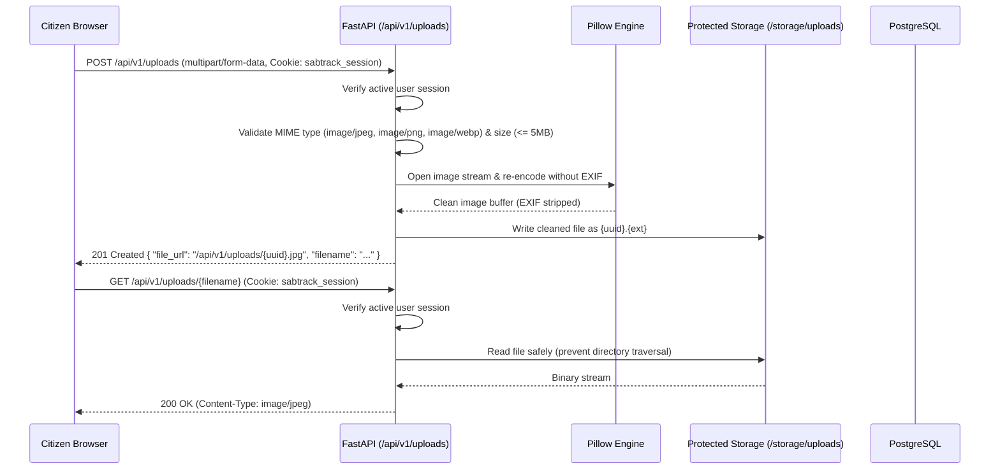
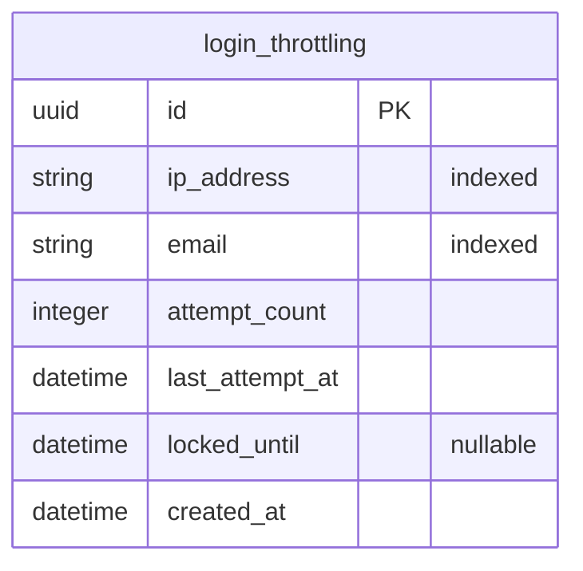

# Phase 5 Design Specification: Production Hardening, Multipart Storage, and Deployment Readiness

**Project:** SABTRACK 3.0  
**Phase:** Phase 5 (Final Phase)  
**Date:** October 25, 2026  
**Authors:** Faith A. Valencia, Jazztin H. Perez, May Sigrid M. Dimaano  
**Status:** PROPOSED (Pending Review & Approval)

---

## 1. Intent and Academic Purpose

Phase 5 represents the final phase of SABTRACK 3.0, transitioning the platform from functional completion (Phases 1–4) to an enterprise-hardened, privacy-compliant, and defense-ready system for Barangay Sabang, Lipa City. 

The primary goals are:
1. **RA 10173 (Data Privacy Act of 2012) Compliance:** Strip sensitive EXIF GPS metadata, camera hardware serials, and timestamps from citizen waste report photos upon upload.
2. **Authenticated Evidence Storage:** Store uploaded photos outside public web directories and serve them strictly through authenticated, role-verified endpoints.
3. **Persistent Brute-Force Rate Limiting:** Migrate the authentication throttling mechanism from volatile in-memory storage to a persistent database-backed ledger that survives server restarts.
4. **Production Configuration Hardening:** Ensure environment-driven security toggles (secure HTTPS session cookies, CORS policies, secure HTTP response headers).
5. **Team Collaboration & Deployment Readiness:** Provide zero-dependency local execution for team members pulling from GitHub, verified container orchestration (`docker-compose.yml`), and automated test validation.

---

## 2. Goals, Non-Goals, and Anti-Goals

### 2.1 Goals
- **Multipart Upload Pipeline:** Secure `POST /api/v1/uploads` endpoint accepting citizen photo submissions (PNG, JPEG, WebP) up to 5MB.
- **Server-Side EXIF Scrubbing:** Use `Pillow` to re-encode uploaded images, permanently stripping EXIF tags before saving to disk.
- **Authenticated File Streaming:** Stream stored evidence via `GET /api/v1/uploads/{filename}` guarded by `get_current_active_user`.
- **Persistent Rate Limiting:** Implement `login_throttling` table via Alembic migration `0007_login_throttling` to track failed login attempts per `(ip_address, email)` tuple across restarts.
- **Frontend File Upload UX:** Replace manual text URL inputs with an intuitive file picker supporting preview, client-side size check, and direct upload in Resident Reports and Participation Claims.
- **Docker Compose & Health Orchestration:** Validate that `docker-compose up` cleanly launches PostgreSQL, applies migrations, runs the API, and serves the Next.js web application.
- **Automated Verification:** Comprehensive Pytest integration tests covering file uploads, EXIF sanitization, authenticated downloads, and persistent throttling.

### 2.2 Non-Goals
- Third-party cloud storage accounts (AWS S3, Google Cloud Storage, Cloudflare R2) requiring paid subscriptions or credit card credentials.
- External distributed cache servers (Redis / Memcached) that introduce operational failure points for local panel demonstrations.
- SMS gateway integration (confirmed out-of-scope in Academic Topic Form).

### 2.3 Anti-Goals
- **Public Upload Directories:** Never expose uploaded citizen photos as unauthenticated static files under `/static` or Next.js `public/`.
- **PII Leakage in Metadata:** Never retain camera device metadata or original file paths.
- **Test Fragility:** Never break SQLite in-memory test isolation (`conftest.py`) or require running Docker containers to execute Pytest or Vitest.

---

## 3. Evaluated Approaches & Decision

### Approach A: PostgreSQL-Backed Throttling & Protected Local Disk Storage *(SELECTED)*
- **Architecture:** 
  - Uploads stored in `apps/api/storage/uploads/` on the server filesystem.
  - Image re-encoding via `Pillow` removes EXIF data and standardizes image formats.
  - Rate limiting recorded in PostgreSQL `login_throttling` table.
- **Advantages:** Zero external dependencies; 100% compatible with existing modular monolith; seamless "git pull and run" for team members (Faith, Jazztin, May Sigrid) without managing cloud credentials; reliable for live thesis defense.
- **Trade-off:** Single-node disk storage (sufficient for barangay scale).

### Approach B: Redis Throttling + Cloud Object Storage (MinIO / AWS S3) *(REJECTED)*
- **Architecture:** Standalone Redis container for rate limits; MinIO container or AWS S3 bucket for photos.
- **Reasons for Rejection:** Adds 2 additional services to run; requires teammates to manage cloud keys or MinIO daemon; introduces external network dependencies and risk of AWS credential leaks on GitHub.

---

## 4. Technical Architecture & Detailed Design

### 4.1 Storage & File Upload Pipeline (`app/modules/storage`)

#### File Security Rules
1. **Filename Sanitization:** The original uploaded filename is discarded. Files are stored as `<UUID4>.<ext>` to prevent path traversal and arbitrary code execution.
2. **MIME & Format Validation:** Only `image/jpeg`, `image/png`, and `image/webp` are accepted. Files are opened with `Pillow` to verify image integrity; fake extension attacks (e.g. `.exe` disguised as `.jpg`) are rejected.
3. **EXIF Stripping:** Images are copied byte-by-byte into a fresh Pillow canvas or saved with `exif=b""`, ensuring zero GPS or camera metadata remains.
4. **Access Control:** `GET /api/v1/uploads/{filename}` requires an authenticated user session (`get_current_active_user`). Unauthorized requests receive `401 Unauthorized`. Path traversal characters (`..`, `/`, `\`) are strictly rejected with `400 Bad Request`.

---

### 4.2 Persistent Rate Limiting (`login_throttling`)

#### Database Schema: Migration `0007_login_throttling`

#### Throttling Logic
- On `POST /api/v1/auth/login`:
  1. Look up `login_throttling` record by `(ip_address, email)`.
  2. If `locked_until > now()`, raise `HTTP 429 Too Many Requests` with remaining seconds.
  3. If attempt fails (invalid password / user not found):
     - Increment `attempt_count`.
     - If `attempt_count >= 5`, set `locked_until = now() + 15 minutes`.
     - Update `last_attempt_at = now()`.
  4. If attempt succeeds:
     - Reset `attempt_count = 0` and clear `locked_until`.

---

### 4.3 Production Configuration & Security Hardening

In `app/core/config.py`:
- `SESSION_COOKIE_SECURE`: Evaluates to `True` when `ENVIRONMENT == "production"` (enforcing `Secure` cookie flag over HTTPS).
- `STORAGE_UPLOAD_DIR`: Configurable path defaulting to `apps/api/storage/uploads`.
- Directory auto-initialization: API startup event creates `STORAGE_UPLOAD_DIR` if not present.
- Git configuration: `apps/api/storage/uploads/*` added to `.gitignore`, keeping `.gitkeep` so the empty folder exists in Git.

---

### 4.4 Frontend Integration

1. **Resident Reports (`/resident/reports`):**
   - File picker component allowing camera capture or file selection.
   - Client-side validation: Max 5MB, images only.
   - Calls `POST /api/v1/uploads` upon selection, displays thumbnail preview, and stores the returned upload URL in `photo_url`.
   - Displays rendered image thumbnail in report details modal using the authenticated image endpoint.
2. **Gamification Claims (`/resident/points`):**
   - Upload file picker for clean-up / recycling photo proof (`evidence_url`).
3. **Admin Consoles (`/admin/reports` & `/admin/participation`):**
   - Renders evidence images using the authenticated `/api/v1/uploads/{filename}` endpoint.

---

## 5. Verification Plan

1. **Backend Integration Tests (`tests/test_storage_and_hardening.py`):**
   - Test image upload: JPEG with synthetic EXIF metadata -> verify returned file has zero EXIF tags.
   - Test non-image upload rejection (`.txt` or disguised binary) -> returns `400 Bad Request`.
   - Test file size limit enforcement (> 5MB) -> returns `413 Payload Too Large`.
   - Test authenticated file retrieval: 200 OK for logged-in user, 401 for unauthenticated request.
   - Test directory traversal prevention (`/api/v1/uploads/../../etc/passwd`) -> returns 400.
   - Test persistent rate limiter: 5 failed attempts locks the IP/email tuple in the database -> 429 response.
2. **Frontend Vitest Component Tests:**
   - Test image upload component rendering, file selection, and progress/thumbnail display.
3. **End-to-End Build & Lint:**
   - `python -m pytest tests -v` (all tests passing hermetically).
   - `npm run build` (Next.js production build clean across all routes).
4. **Docker Verification:**
   - Confirm `docker-compose.yml` config matches production requirements.

---

## 6. What Is Left to the Builder

- Exact image compression ratio (85% JPEG quality recommended for optimal storage savings).
- Local storage directory structure (flat UUID naming vs. dated folders).
- Specific SVG iconography for upload progress/preview cards.
