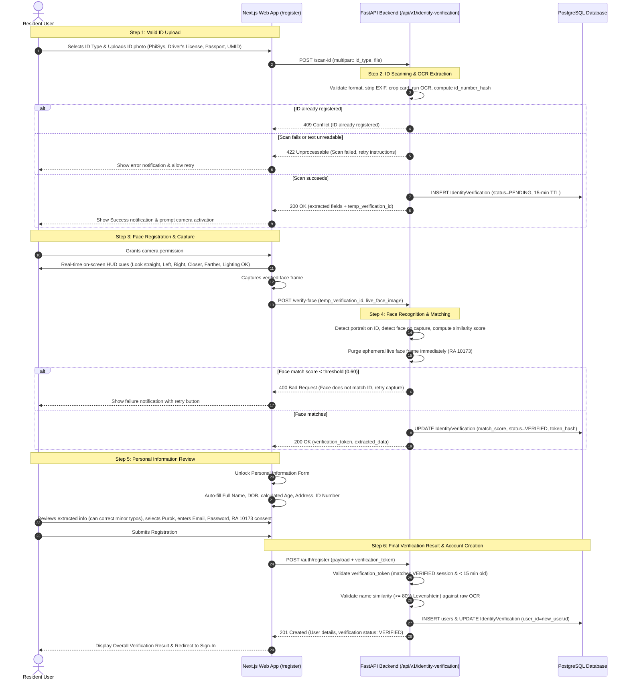

# Design Document: IT-312 Integrated Identity Verification System in SABTRACK Registration

**Date:** 2026-11-22  
**Status:** Ready for Approval  
**Authors:** AI Assistant & SABTRACK Project Proponents  
**Target:** SABTRACK 3.0 (FastAPI Backend + Next.js App Router Frontend)  

---

## 1. Intent & The "Why"

Barangay Sabang's digital governance platform (SABTRACK) requires trustworthy identity verification for residents registering for municipal waste operations, violation reporting, and civic rewards. Under academic guidelines for the IT-312 Final Project (*Integrated Identity Verification System*), resident registration must be elevated from an unverified manual input form into an integrated, automated identity verification workflow combining **Government-Issued ID Verification** (via Optical Character Recognition) and **Live Face Recognition** (via camera capture with directional liveness cues).

This ensures:
1. Only authentic residents possessing supported government credentials register.
2. The person registering in front of the device matches the photograph on the uploaded government ID.
3. Personal details (Name, Date of Birth, Age, Address, ID Number) are extracted and pre-populated directly from verified credentials, minimizing manual data entry and identity spoofing.

---

## 2. Goals, Non-Goals, and Anti-Goals

### Goals
- **Enforce Mandatory 6-Step Sequence (Section II.1):**
  1. Valid ID Upload (PhilSys National ID, Driver's License, Passport, UMID).
  2. ID Scanning & Information Extraction (OCR for Full Name, DOB, Address, ID Number, Expiry).
  3. Interactive Face Registration & Capture (live camera with real-time pose guidance: straight, turn left, turn right, closer, farther, lighting check).
  4. Face Recognition & Identity Matching (compare ID photo crop against captured face with confidence threshold >= 0.60).
  5. Personal Information Interface (locked until steps 1-4 pass; auto-fills Name, DOB, Age, Address, ID Number; allows user review, purok selection, email, and password setup).
  6. Final Verification Result (save audit/verification record, display verification status, and complete resident account creation).
- **Controlled Review with Dual-Audit Guardrails:** Allow residents to correct minor OCR character typos in Step 5 while computing Levenshtein similarity against raw OCR text (blocking deviations below 80% to prevent identity swapping) and persisting both raw OCR and submitted values with `is_user_corrected` flags.
- **Duplicate Prevention:** Enforce unique resident accounts per physical ID card using deterministic `id_number_hash = SHA256(normalized_id_number)` with a database unique index.
- **Graceful Failure & Retries:** Provide clear notifications and retry paths when an ID is unreadable, blurry, unsupported, or when facial matching fails or is inconclusive.
- **Privacy & Security Compliance (RA 10173):** Strip EXIF data from uploaded credentials, hash sensitive session data, store ID verification logs in authenticated non-public storage, purge live biometric capture frames immediately after matching, and provide explicit consent acknowledgments.
- **Hermetic Testing:** Provide unit tests with synthetic/sample fixtures (`is_demo_data=True`) verifying the full verification pipeline without external API fees or real citizen PII.

### Non-Goals
- **Physical ID Hologram/NFC Chip Authentication:** Visual and biometric verification only; no hardware chip-level cryptographic PKI verification.
- **Paid Third-Party SaaS Integration:** Zero paid APIs (e.g. AWS Rekognition, Onfido); entirely open-source Python (OpenCV, Tesseract/EasyOCR) and native browser APIs.
- **Staff/Admin Overhaul:** Focuses on the resident registration onboarding flow. Manual administrative dispute resolution portals are out of scope for this phase.

### Anti-Goals
- **Unverified Backdoors:** The personal information and password submission step must NOT be accessible or submittable without passing backend-validated ID scanning and facial matching.
- **PII / Biometric Exposure:** Never log raw facial embeddings, unhashed tokens, or raw biometric images in system log files.

---

## 3. Approaches Considered

### Approach A: Pure Server-Heavy Processing
- **Description:** Frontend acts as a dumb file uploader. Uploads raw ID image and static webcam selfies. FastAPI backend handles OpenCV ID cropping, OCR, face detection, and similarity comparison.
- **Tradeoffs:** Minimal frontend code, but clunky user experience without live camera guidance.

### Approach B: Hybrid Interactive Engine *(Selected)*
- **Description:** Next.js frontend runs an interactive camera HUD that guides the resident in real-time through head poses (straight, left, right, distance, lighting) and captures clear frames. The captured frames and ID scan are submitted to FastAPI verification endpoints. The backend runs OpenCV (face detection/cropping, image normalization) and OCR (Tesseract / EasyOCR / fallback parser) to extract fields and compute facial similarity between the ID portrait and live captures, issuing a cryptographically signed verification session token.
- **Tradeoffs:** Matches Section I.3 and II.1 of the IT-312 guidelines perfectly; provides fluid interactive user feedback while preserving backend security authority and database integrity.

### Approach C: Pure Client-Side Browser Engine (WebAssembly)
- **Description:** Run all OCR and face matching in the browser using Tesseract.js and browser neural network weights, sending only the final text to the backend.
- **Tradeoffs:** Heavy client bundles (30MB+ models), poor performance on mobile/budget devices, and high risk of client-side payload tampering.

---

## 4. System Architecture & Detailed Flow

---

## 5. Component Breakdown

### 5.1 Backend (`apps/api`)
1. **Module `app/modules/identity_verification`:**
   - `models.py`:
     - `IdentityVerification`:
       - `id`: Integer primary key
       - `user_id`: ForeignKey to `users.id` (nullable initially, linked upon successful registration)
       - `id_type`: Enum (`PHILIPPINE_NATIONAL_ID`, `DRIVERS_LICENSE`, `PASSPORT`, `UMID`)
       - `id_number_hash`: String(64) indexed, unique (SHA-256 of normalized ID number for duplicate prevention)
       - `id_number_masked`: String(50) (e.g. `****-****-1234` for safe audit display)
       - `ocr_full_name`: String(150) (raw text extracted from ID)
       - `submitted_full_name`: String(150) (final name submitted by resident)
       - `is_user_corrected`: Boolean (default=False)
       - `dob_extracted`: Date
       - `address_extracted`: Text
       - `match_score`: Float (confidence metric 0.0 - 1.0)
       - `status`: Enum (`PENDING`, `VERIFIED`, `REJECTED`, `FLAGGED`)
       - `verification_token_hash`: String(64) (SHA-256 hash of single-use token granting registration)
       - `token_expires_at`: DateTime(timezone=True)
       - `is_demo_data`: Boolean (default=False)
       - `created_at`, `updated_at`
   - `services/ocr_service.py`:
     - Extracts structured text using open-source Python OCR engine (OpenCV preprocessing + Tesseract/EasyOCR fallback heuristics).
     - Strips EXIF metadata, checks sharpness/contrast, and validates completeness of extracted fields.
   - `services/face_matching_service.py`:
     - Detects facial regions on the ID document and the captured live selfie frame using OpenCV Haar/DNN cascades.
     - Performs facial comparison using structural feature/histogram similarity metrics with a configurable acceptance threshold (`>= 0.60`).
2. **Endpoints `app/api/v1/endpoints/identity_verification.py`:**
   - `POST /identity-verification/scan-id`: Validates ID document, extracts personal fields, checks for duplicate `id_number_hash`, persists `PENDING` verification record, and caches temporary portrait crop.
   - `POST /identity-verification/verify-face`: Matches live captured face against ID portrait, purges live image immediately, sets `status=VERIFIED`, and returns single-use `verification_token`.
3. **Registration Integration `app/api/v1/endpoints/auth.py`:**
   - Update `UserCreate` schema to require `verification_token`.
   - Verify token validity, verify string similarity between `submitted_full_name` and `ocr_full_name` (>= 80%), and link `IdentityVerification.user_id`.

### 5.2 Frontend (`apps/web`)
1. **Registration Flow Redesign (`/register/page.tsx`):**
   - Multi-step progress indicator:
     1. **Step 1: ID Upload & Supported Cards Overview** (PhilSys, Driver's License, Passport, UMID)
     2. **Step 2: ID Scanning & OCR Validation** (with retry options for unreadable/unsupported images)
     3. **Step 3: Interactive Face Registration & Capture HUD** (live camera video stream, pose checklist: Center, Turn Left, Turn Right, Lighting Check)
     4. **Step 4: Facial Biometric Matching** (with retry option on mismatch)
     5. **Step 5: Personal Information Review** (locked until Steps 1-4 pass; pre-populated Name, DOB, calculated Age, Address, ID Number; allows minor typo correction; captures purok, email, password, and RA 10173 consent)
     6. **Step 6: Final Verification Result & Confirmation**
2. **Camera HUD Component (`src/components/verification/FaceCaptureModal.tsx`):**
   - Accessible video preview with overlay guide, canvas snapshot extraction, and real-time pose guidance cues.

---

## 6. Security, Privacy, and RA 10173 Compliance

1. **Ephemeral Biometric Purge:** Live facial capture frames are purged immediately from memory/disk upon matching.
2. **Non-Public ID Document Storage:** Stored ID scans are stripped of EXIF metadata and placed in authenticated non-public local storage (`storage/secure_id_records/`).
3. **No PII/Biometric Leaks in Logs:** Application logs only record event IDs and masked identifiers (`id_number_masked`).
4. **Single-Use Verification Tokens:** Cryptographically random (32 bytes), hashed with SHA-256 before database storage, strict 15-minute TTL, consumed exactly once upon registration.
5. **Data Privacy Consent:** Dedicated RA 10173 consent checkbox informs the resident of identity verification purposes before camera activation.

---

## 7. What is Left to the Builder
- Selection and graceful degradation between Tesseract/EasyOCR and OpenCV Haar/DNN cascades based on the hosting environment's available system binaries.
- Fine-tuning the exact face match similarity threshold and blur-detection variance (Laplacian threshold) to minimize false rejections in varied lighting conditions.
- Polish on CSS animations for the camera HUD guide and step transitions.
